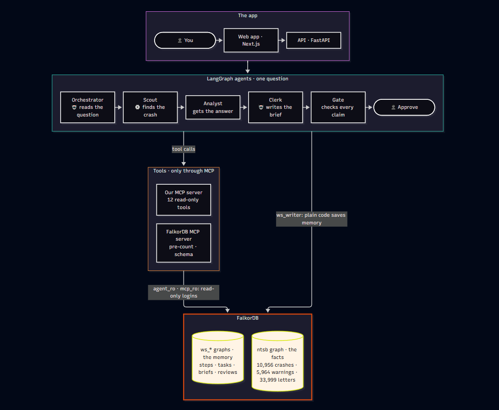
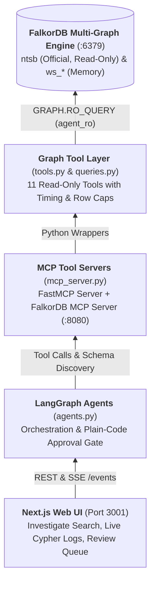
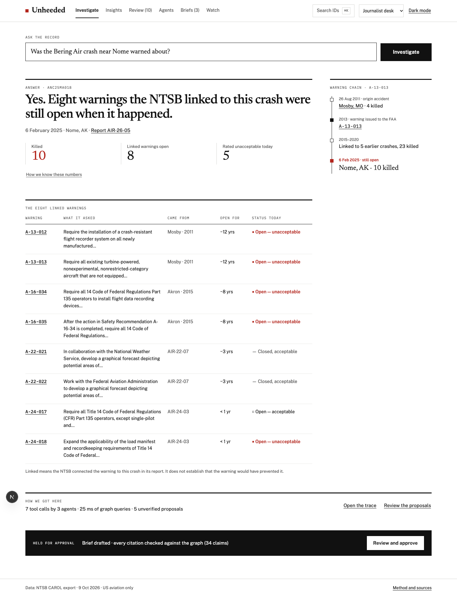
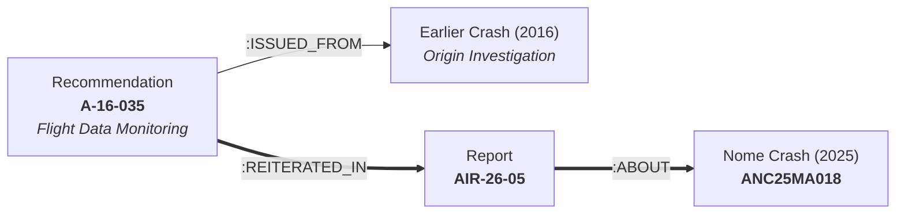
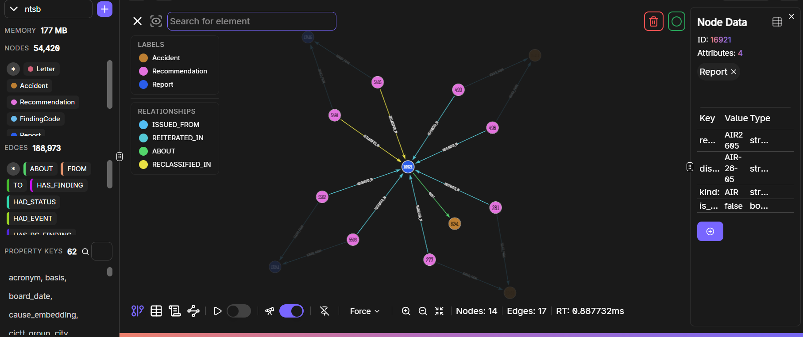
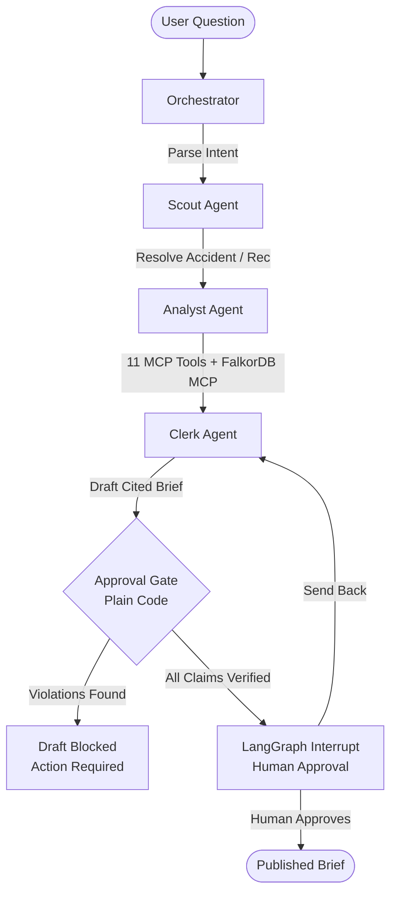
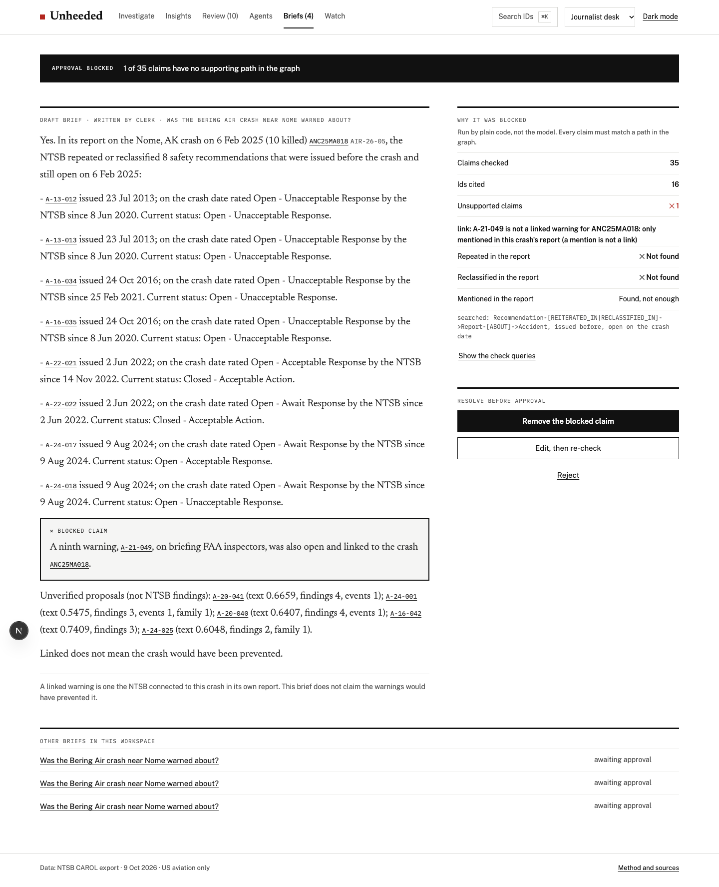

# ✈️ Unheeded

**For any US aviation crash: had the NTSB already warned about the underlying safety hazard, and was that warning still open on the day it happened?**

Unheeded answers from public National Transportation Safety Board (NTSB) investigation records. It uncovers recurring aviation hazards by traversing a multi-tier knowledge graph in **FalkorDB**, coordinates autonomous **LangGraph** agents with sub-millisecond graph queries, and enforces a deterministic, plain-code approval gate so that **nothing is published without human sign-off**.

[](https://www.falkordb.com/)
[]()
[]()
[](LICENSE)

---

### 🏆 FalkorDB Hackathon Showcase ("Graph Hacks: Context for AI Agents")

Unheeded competes across three hackathon tracks:
* **Track 1 · Agents Acting on Connected Data:** Orchestrator, Scout, Analyst, and Clerk agents use 11 custom MCP tools and FalkorDB's MCP server over an NTSB knowledge graph to resolve crashes, trace supersessions, find shortest causal paths, and draft evidence-backed briefs.
* **Track 2 · Agent Memory & Coordination:** Dedicated per-workspace graphs (`ws_<name>`) manage episodic step logs, atomic 60-second task leases across concurrent agents, semantic candidate links, and procedural rule weights fitted from human review (boosting recurring gold warnings from 25% to 50% Hit@10 on held-out crashes).
* **Track 3 · Company Brain & Change Reach:** 34,000 deduplicated correspondence letters between the NTSB and the FAA serve as an institutional ticket thread. Bi-temporal status histories trace decisions to specific letters, and Watch mode uses BFS graph traversal to calculate the alert blast radius when safety recommendations change.

> 🎥 **Demo Video:** [Google Drive Walkthrough Video](https://drive.google.com/file/d/1lutTRs0wSzoEalahycBXmx1_OGgRLEIJ/view?usp=sharing)  
> 💻 **Deployment:** Local demo (not hosted externally). Run locally in under 3 minutes with zero API keys required (see [Quickstart](#-quickstart--judge-evaluation-guide)).

---

## 📐 System Architecture



Unheeded separates facts from reasoning using a strict hierarchy: **The graph holds the facts, the LLM reasons, and plain code holds final authority.**

* **The Model Never Guesses:** Facts (dates, fatality counts, NTSB IDs, and statuses) originate exclusively from FalkorDB Cypher queries.
* **Deterministic Fact-Checking Gate:** Every brief draft passes through a strict Python verification parser before reaching a human reviewer.
* **Database-Enforced Security:** Read-only access is enforced by FalkorDB ACLs (`agent_ro` user permits only `GRAPH.RO_QUERY`), eliminating prompt-injection risks at the database layer.




---

## 🎯 The Core Problem & The "One Definition"

The NTSB investigates civil aviation accidents and issues safety recommendations to regulatory bodies (such as the FAA), manufacturers, and airlines. However, the NTSB has **no regulatory authority**—it can only recommend. Addressees reply by letter, and the NTSB board rates their responses as *Open—Acceptable*, *Open—Unacceptable*, or *Closed*. 

Many critical safety recommendations sit in an *Open—Unacceptable Response* status for years—sometimes decades—while subsequent fatal crashes occur under identical circumstances.

> *"Unheeded" is an empirical question, not a verdict of liability.*  
> A linked warning shows an unheeded systemic recommendation; it does not prove that acting upon it would have prevented the crash.

### The Strict 3-Condition Definition
A safety recommendation is classified as a **linked warning** for a crash if and only if all three conditions are satisfied:
1. The NTSB explicitly **repeated or reclassified** the recommendation in that crash's official investigation report (a passing mention does not count).
2. It was **issued prior to** the crash date.
3. It was **still open** on the date of the crash.

Across the public NTSB CAROL database (1967–2026), this strict standard identifies **16 fatal crashes, 54 linked warnings, and 48 fatalities**.



*Example:* In the 6 Feb 2025 Bering Air crash near Nome, Alaska ([`ANC25MA018`]), **8 recommendations** repeated in the report were issued beforehand and open on crash day (4 rated *Open—Unacceptable Response* then, 5 rated unacceptable today). Among them, **A-16-035** (mandating flight data monitoring for Part 135 operators) was issued in 2016, repeated across 7 reports, and tied to 5 crashes killing 31 people.

### How Links Are Discovered & Verified
* **Connecting Raw Records:** The raw NTSB CAROL data does not contain a pre-joined "linked warning" table. When the NTSB repeats or reclassifies an earlier warning in a subsequent investigation, the report number (e.g., `AIR-26-05`) appears in official correspondence and classification letters. Unheeded parses and normalizes these report numbers during ingestion, creating explicit graph edges (`:REITERATED_IN`, `:RECLASSIFIED_IN`, `:MENTIONED_IN`) connecting `Recommendation` nodes to `Report` and `Accident` nodes.
* **Independent Non-Graph Control (`gold_links.py`):** To ensure rigorous evaluation integrity, the project maintains an independent non-graph reference implementation ([`data/scripts/gold_links.py`]). It directly parses the 3 raw CAROL JSON files without touching the graph, deduplicates letters, applies the 3-condition rule, and compiles the exact 54-link answer key ([`data/derived/gold_links_strict_definition.json`]). **Eval 1 audits the FalkorDB Cypher queries against this independent non-graph baseline, proving 100% agreement (54/54 recovered, 0 near-miss false positives).**

---

## ⚡ Why FalkorDB is Essential

A relational database or standalone vector store cannot effectively power this system. FalkorDB delivers:



1. **Multi-Hop Traversal with Temporal Logic:**  
   Identifying whether an accident was preceded by an open warning requires traversing `(:Recommendation)-[:REITERATED_IN|RECLASSIFIED_IN]->(:Report)-[:ABOUT]->(:Accident)` with temporal inequality filtering across issuance, event, and closure dates. FalkorDB executes this 2-hop search in **0.53 ms**.
2. **Bi-Temporal Edge History (`HAD_STATUS`):**  
   Recommendations change status over time as letters are exchanged. FalkorDB models status transitions as individual edges with `{valid_from, valid_to, basis, letter}` properties. An agent can query the exact status of a recommendation on the day of a crash decades ago in **0.12 ms**.
3. **Graph Algorithms at Native Speed:**
   * **Shortest Paths (`algo.SPpaths`):** Explains candidate connections between unlinked crashes and warnings through hub-pruned probable-cause findings in **≤ 0.43 ms**.
   * **Supersession Trees (`[:SUPERSEDED_BY*1..10]`):** Traverses variable-depth recommendation replacement chains (e.g., A-00-066 fanning out into A-24-004 through 006) in **≤ 0.71 ms**.
   * **Community Detection (`algo.labelPropagation`):** Partitions 10,956 accidents into causal failure families based on shared findings and defining flight events.
   * **Alert Reach (`algo.BFS`):** When NTSB exports update, a 2-level BFS computes the blast radius of affected organizations, crashes, and superseding warnings.
4. **Database-Enforced Security:**  
   Agents run under FalkorDB ACLs restricted to `GRAPH.RO_QUERY` (`NOPERM` on write/delete). Official NTSB data is physically separated from workspace memory graphs (`ws_<name>`), ensuring agents can never contaminate official records.

---

## 📊 Graph Data Model & Cypher in Action

For complete schema details and index specifications, see [docs/graph-schema.md](docs/graph-schema.md).



### Node & Relationship Overview

| Node Label (Graph `ntsb`) | Count | Key Properties | Source |
| :--- | :--- | :--- | :--- |
| **Recommendation** | 5,964 | `srid`, `text`, `status_code`, `is_open`, `issued_date`, `closed_date`, `times_reiterated`, `text_embedding`, `impact_score` | NTSB CAROL Recommendations Export |
| **Accident** | 10,956 | `ntsb_num`, `event_date`, `city`, `state`, `lat`, `lon`, `fatal`, `probable_cause`, `family_id`, `cause_embedding` | NTSB Aviation Investigations |
| **Report** | 526 | `report_num`, `display`, `kind`, `report_date`, `is_study` | Board Investigation Reports & Studies |
| **Letter** | 33,999 | `id`, `date`, `type`, `from_ntsb`, `summary` | Deduplicated NTSB/FAA Correspondence |
| **Organization** | 395 | `name`, `acronym` | Addressees & Operators |
| **Status** | 15 | `code` (e.g., OUA, OAA, CUAA), `label` | Official NTSB Classification Codes |
| **FindingCode** | 2,318 | `code`, `tier1`..`tier4` | Coded Probable Cause Finding Tiers |
| **EventType** | 247 | `cictt_group`, `phase` | CICTT Event Types & Occurrence Phases |

### Signature Cypher: The Headline Query
This query retrieves linked warnings that were active on the exact day of a crash and recovers their historical rating at that moment:

```cypher
// backend/unheeded/queries.py -> FIND_OPEN_WARNINGS
MATCH (r:Recommendation)-[:REITERATED_IN|RECLASSIFIED_IN]->(:Report)-[:ABOUT]->(a:Accident {ntsb_num: $id})
WHERE NOT (r)-[:ISSUED_FROM]->(a) 
  AND r.issued_date < a.event_date
  AND (r.closed_date IS NULL OR r.closed_date > a.event_date)
WITH DISTINCT r, a
OPTIONAL MATCH (r)-[h:HAD_STATUS]->(s:Status)
WHERE h.valid_from <= a.event_date AND (h.valid_to IS NULL OR h.valid_to > a.event_date)
RETURN r.srid AS srid,
       r.issued_date AS issued,
       s.label AS status_on_crash_date,
       h.valid_from AS status_since,
       r.status_label AS current_status,
       r.times_reiterated AS times_reiterated
ORDER BY issued, srid
```

<details>
<summary>🔍 Click to view Cypher for Negative Proof and Shortest-Path Explanations</summary>

#### Negative Proof (Proving No Linked Warning Exists)
Verifies that no warning path exists while checking that an NTSB report actually exists in the dataset (preventing false "proven absent" claims on uninvestigated flights):

```cypher
// backend/unheeded/queries.py -> PROVE_NO_LINKED_WARNING
MATCH (a:Accident {ntsb_num: $id})
OPTIONAL MATCH (p:Report)-[:ABOUT]->(a)
WITH a, collect(DISTINCT p.display) AS reports
OPTIONAL MATCH (r:Recommendation)-[:REITERATED_IN|RECLASSIFIED_IN]->(:Report)-[:ABOUT]->(a)
WHERE NOT (r)-[:ISSUED_FROM]->(a) 
  AND r.issued_date < a.event_date
  AND (r.closed_date IS NULL OR r.closed_date > a.event_date)
RETURN a.ntsb_num AS ntsb_num,
       count(DISTINCT r) = 0 AS no_linked_warning,
       reports
```

#### Undirected Shortest Path (`algo.SPpaths`)
Finds the shortest explanatory bridge between a crash and an unlinked recommendation through probable-cause findings:

```cypher
// backend/unheeded/queries.py -> EXPLAIN_PATH
MATCH (r:Recommendation {srid: $srid}), (a:Accident {ntsb_num: $id})
CALL algo.SPpaths({
  sourceNode: r, 
  targetNode: a, 
  relDirection: 'both', 
  maxLen: 4, 
  pathCount: 1,
  relTypes: ['REITERATED_IN', 'RECLASSIFIED_IN', 'ABOUT', 'ISSUED_FROM', 'HAS_PC_FINDING', 'HAD_DEFINING_EVENT']
})
YIELD path
RETURN [n IN nodes(path) | coalesce(n.srid, n.display, n.ntsb_num, n.code)] AS nodes,
       [e IN relationships(path) | type(e)] AS edges
```
</details>

---

## 🤖 Multi-Agent Workflow & Approval Gate

Investigations are coordinated through **LangGraph** across four specialized roles and two deterministic checkpoints:



### Agent Roles & Plain-Code Guarantees

| Agent / Step | Pure Code Enforcement | Model Decision Scope |
| :--- | :--- | :--- |
| **Orchestrator** | Validates plan JSON; falls back to deterministic regex parser if schema check fails. | Classifies question into `crash`, `recommendation`, or `owner`. |
| **Scout** | Resolves crashes via RediSearch full-text search; strictly refuses to guess on ambiguous names. | None. |
| **Analyst** | Always runs mandatory Cypher headline queries; enforces tool allowlist and budget (≤ 6 calls). Persists proposals only if score ≥ 0.5. | Selects additional tools for context (chain of custody, letters, candidate links). |
| **Clerk** | Receives structured facts JSON only; warning counts are pre-calculated by code to prevent counting hallucinations. | Formulates clear, professional prose citing entities in brackets (`[A-16-035]`). |
| **Approval Gate** | **100% deterministic Python parser**: parses every line into assertions (IDs, links, dates, statuses, fatalities, individual names) and verifies each against Cypher queries. | None. |
| **Approval** | Pauses execution via LangGraph `interrupt()`. Brief is saved only when a human reviewer approves. | None. |

### The Plain-Code Approval Gate in Action

If the model attempts to claim that a recommendation was "linked" when the NTSB only mentioned it, or invents a date, the Gate halts publication:



---

## 🧠 Agent Memory & Coordination (Track 2)

Unheeded isolates agent state by deploying **one FalkorDB graph per workspace** (`ws_<name>`), separating operational memory from the shared official record:

* **Episodic Memory:** Every agent tool execution is logged as an immutable `Step` node recording the exact Cypher query, return count, and wall-clock milliseconds.
* **Coordination Leases:** Agents claim tasks via atomic queries (`claim_task`). If an agent dies, its 60-second lease expires and another worker claims it. In concurrency benchmarks, **64 concurrent claim attempts across 32 agents on 10 tasks resulted in exactly 10 distinct task assignments with zero race conditions**.
* **Semantic Candidates:** Unverified proposals generated via text similarity (`vec.cosineDistance`), shared findings, and family clusters.
* **Procedural Learning & Dynamic Re-fitting:** When human reviewers confirm or reject unstated proposals in the Review Queue (`/review`), decisions are persisted as `Candidate` nodes in `ws_<name>`:
  * **Dynamic Weight Fitting:** Rather than relying on static formulas, the workspace dynamically fits logistic regression weights across signal values (text cosine, shared findings, CICTT events, failure families) once $\ge 10$ decisions (with at least one confirmation and one rejection) accumulate.
  * **Retrieval Seeds:** Confirmed pairs automatically become retrieval seeds.
  * **Continuous Improvement:** When a new investigation is launched, the workspace queries its candidate graph, applies the learned weights and seeds bonus, and prioritizes recurring warnings (demonstrated in Eval 2: top-10 recall on held-out crashes jumps from 25% to 50%).

### Live Streaming Execution (`/api/runs` & SSE `/events`)
When a user launches an investigation, the frontend opens a live Server-Sent Events stream (`GET /api/runs/{thread}/events`). Each agent step—including the agent role, tool called, exact Cypher query, result count, and server-side execution milliseconds—is streamed in real-time to the browser and rendered as interactive docket tiles with shortest-path graph links.

---

## 📈 Evaluation & Benchmarks (`make eval`)

Run all evaluations locally using `make eval` (or via Python directly). Reports are saved to `backend/eval/report_*.json`:

| Eval Suite | Benchmark Target | Verified Result |
| :--- | :--- | :--- |
| **Eval 1: Linked-Warning Recovery** | 54 gold links across 16 crashes | **54/54 recovered (100% recall)**. **0 false positives** on 61 near-miss traps (mentions or post-crash issuances). Median query time: **0.53 ms**. |
| **Eval 2: Learning from Review** | Hidden-half leave-one-out ranking | Top-10 recall increases from **25% → 50%** (MRR 0.066 → 0.418). Candidates checked per crash drops from 8.87 to 5.82. |
| **Eval 3: Approval Gate Verification** | 40 synthetic test claims (20 valid, 20 planted errors) | **0 verification errors**. 20/20 planted mistakes caught and blocked; 20/20 valid claims passed. 16/16 full agent briefs verified cleanly. |
| **Eval 4: Graph Performance & Latency** | Live FalkorDB graph operations | Supersession chains: **≤ 0.71 ms**; shortest paths: **≤ 0.43 ms**; p95 tool call latency during full agent investigations: **37 ms**. |
| **Concurrency Benchmark** | High-throughput multi-agent execution | **6,808 writes/sec** across workspace graphs; 64 concurrent claim attempts across 32 agents on 10 tasks → **10 distinct claims**. |

---

## 🚀 Quickstart & Judge Evaluation Guide

You can run the entire system **100% offline with zero external API keys** using the built-in deterministic stub model, or plug in OpenRouter for live LLM reasoning.

### Prerequisites
* [Docker](https://docs.docker.com/get-docker/) & Docker Compose
* [uv](https://docs.astral.sh/uv/) (Fast Python package manager)
* [Node.js](https://nodejs.org/) (v20+) & `npm`

---

### Step 1: Clone & Configure Environment

```bash
git clone https://github.com/Harshul-Dwivedi/Unheeded.git
cd Unheeded
```

**Generate `.env`:**
* **Linux / macOS:**
  ```bash
  make env
  ```
* **Windows (PowerShell):**
  ```powershell
  if (-not (Test-Path .env)) {
    $envContent = Get-Content .env.example -Raw
    $envContent = $envContent -replace 'AGENT_RO_PASSWORD=.*', "AGENT_RO_PASSWORD=$([System.Guid]::NewGuid().ToString('N'))"
    $envContent = $envContent -replace 'WS_WRITER_PASSWORD=.*', "WS_WRITER_PASSWORD=$([System.Guid]::NewGuid().ToString('N'))"
    $envContent = $envContent -replace 'MCP_RO_PASSWORD=.*', "MCP_RO_PASSWORD=$([System.Guid]::NewGuid().ToString('N'))"
    $envContent = $envContent -replace 'MCP_API_KEY=.*', "MCP_API_KEY=$([System.Guid]::NewGuid().ToString('N'))"
    Set-Content .env $envContent
    Write-Host "Created .env with secure random credentials."
  }
  ```

*(Optional: Set `LLM_PROVIDER=openrouter`, `OPENROUTER_API_KEY=sk-...`, and `LLM_MODEL=anthropic/claude-3.5-sonnet` in `.env` to enable live LLM generation. By default, `LLM_PROVIDER=stub` runs completely offline).*

---

### Step 2: Start FalkorDB Services

```bash
docker compose up -d
```
Verify containers are healthy:
* FalkorDB: `http://127.0.0.1:6379` (Redis protocol) and browser at `http://127.0.0.1:3000`
* FalkorDB MCP Server: `http://127.0.0.1:8080/mcp`

---

### Step 3: Install Dependencies & Load Data

```bash
# 1. Install Python dependencies
cd backend && uv sync

# 2. Ingest NTSB CAROL data & enrich graph (embeddings, PageRank, Label Propagation)
uv run python -m unheeded.loader
uv run python -m unheeded.enrich

# 3. Install frontend web dependencies
cd ../web && npm install
cd ..
```
*(Ingestion takes ~15 seconds; first-time local embedding generation takes ~5 minutes. Subsequent loads use the local `.cache/embeddings.npy` in seconds).*

---

### Step 4: Run Tests & Verification

Verify the entire test suite (**39 tests passing**):
```bash
cd backend
uv run pytest -q
```

Run the benchmark evaluation suite:
```bash
uv run python -m eval.eval1
uv run python -m eval.eval2
uv run python -m eval.eval3
uv run python -m eval.eval4
uv run python -m eval.concurrency
cd ..
```

---

### Step 5: Run the Investigation System

#### Option A: Terminal CLI Execution
Run the end-to-end agent investigation on the Nome crash:
```bash
cd backend
uv run python -m unheeded.agents "Was the Bering Air crash near Nome warned about?" --workspace demo --decision approve
```

#### Option B: Full Web Application (Next.js + FastAPI)
* **Start Backend API (Terminal 1):**
  ```bash
  cd backend
  uv run uvicorn unheeded.api:app --host 127.0.0.1 --port 8000
  ```
* **Start Frontend Interface (Terminal 2):**
  ```bash
  cd web
  npm run dev
  ```
Open **`http://127.0.0.1:3001`** in your browser (*port 3001 avoids conflict with FalkorDB's browser on port 3000*).

---

## 🛠️ Troubleshooting

* **Port 3000 vs 3001:** FalkorDB exposes its native graph browser on port `3000`. The Next.js frontend is configured to run on port `3001`.
* **FalkorDB ACL Permissions (`NOPERM`):** If tests fail with `NOPERM`, verify that your `.env` contains valid strings for `AGENT_RO_PASSWORD`, `WS_WRITER_PASSWORD`, and `MCP_RO_PASSWORD`, and restart containers using `docker compose down && docker compose up -d`.
* **FastEmbed First-Time Download:** The first run of `unheeded.enrich` downloads `BAAI/bge-small-en-v1.5` (~130MB). Ensure an active internet connection during initial loading.

---

## ⚠️ Methodological Limits & Transparency

In aviation safety, precision is paramount. We explicitly note what the system does and does not claim:
1. **Correlation vs Causation:** A linked warning does not establish that acting upon the recommendation would have prevented the accident.
2. **Report Availability:** Only 520 of 10,956 crashes in the export have a finalized NTSB report attached. For crashes lacking a report, the system explicitly returns "nothing to search" rather than declaring absence of warnings.
3. **Privacy by Design:** Signatories and personal names in NTSB letters are scrubbed before storage, and briefs mentioning individuals are blocked by the Approval Gate.
4. **Candidate Links Are Not Facts:** Unverified candidate links generated by graph topology and vector similarity are strictly quarantined under a distinct `"Unverified Proposals"` banner and never count toward official tallies.

---

## 🤖 AI Assistance Disclosure

In accordance with hackathon guidelines:
* **Development Assistance:** **Claude Code** and **Cursor Agent** were used as AI coding assistants to help with the implementation, routines, structure test suites, and refine documentation under human supervision.
* **Testing Model:** **Claude Sonnet 4.5** (via OpenRouter) was used during development to validate real-model LLM tool selection, multi-turn reasoning, and draft brief writing.
* **Runtime Architecture:** The application runtime defaults to a deterministic, offline mock model (`LLM_PROVIDER=stub`) and can optionally be configured to use any OpenAI-compatible API endpoint via OpenRouter.
* **Human Responsibility:** All architectural design, graph schemas, Cypher templates, security constraints, and evaluation criteria were directed, reviewed, and verified by the submitter.

---

## 👥 Authors & License

* **Author:** Harshul Dwivedi ([@Harshul-Dwivedi](https://github.com/Harshul-Dwivedi))
* **License:** [MIT License](LICENSE)
