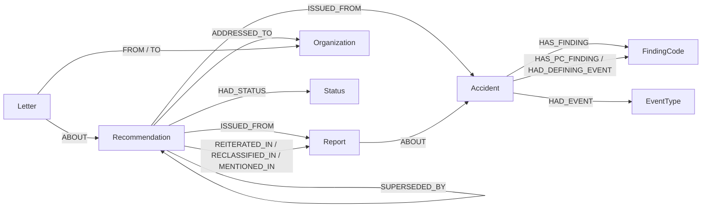

# Unheeded

**For any US aviation crash: had the NTSB already warned about this, and was that warning still open on the day it happened?**
Unheeded answers from the public NTSB record, shows the path behind every answer, proposes possible connections that are
not in the NTSB record (clearly marked unverified), and publishes nothing without a person's approval. Built on FalkorDB.

*"Unheeded" is a question, not a verdict.* We show which NTSB warnings were still open the day a plane crashed, and how the
NTSB itself rated the response then. Often it was rated acceptable.

## What it does

Ask *"Was the Bering Air crash near Nome warned about?"* Four agents walk the graph. The answer: **yes, eight
recommendations the NTSB repeated or reclassified in that crash's report were issued before it and still open on
6 Feb 2025; four were rated Open—Unacceptable Response by the NTSB on the crash date, five are rated unacceptable today.** One of them, A-16-035 (flight data monitoring for Part 135
operators), was issued in 2016, repeated 7 times, and linked to five crashes that killed 31 people. Every number links
back to its record; every step shows its Cypher and its milliseconds; a plain-code gate checks every claim before a person approves the brief.


A linked warning does not establish that acting on it would have prevented the crash.

## Tracks entered

- **Track 1 · Agents that act on connected data.** Orchestrator → Scout → Analyst → Clerk (LangGraph) choose among 11 MCP tools
  over the graph, draft a cited brief, and stop at a deterministic approval gate plus a human decision.
- **Track 2 · Agent memory and coordination.** One FalkorDB graph per workspace: episodic Steps, Tasks with leases (one
  atomic claim query; 64 concurrent attempts on 10 tasks → each claimed once), semantic Candidates, procedural Rules.
  Confirmed links bring recurring warnings back: gold link in the top 10 **25% → 50%** on held-out crashes (Eval 2,
  leave-one-out +25 points, 95% interval 6–44). Honestly measured: the gain is warnings that recur across crashes; it does
  not find new ones.
- **Track 3 · Company brain.** 34,000 deduplicated letters between the NTSB and the FAA (and others) are the ticket thread;
  addressees are the owners (the FAA has 228 open, 71 rated Open—Unacceptable Response); every status change is traced
  to the letter where the Board decided it (bi-temporal status history); a refresh diffs a newer export and raises alerts
  on whatever the change reaches in the graph (BFS, crashes kept only if linked by the definition).

## The graph does the work

The headline answer is a 2-hop pattern with date conditions (recommendation → report → crash) over a small, exact part of
the record, and the "no" answer is a proof that no such path exists, which says what it searched (a crash with no NTSB report
has nothing to search, and the answer says so). That part a relational join could also do. Where the graph earns its place:
proposing connections that are not in the record (shared probable-cause findings two hops away, text similarity, and
confirmed links as seeds), explaining them as shortest paths through hub-pruned causes, supersession as variable-length
paths, families by label propagation, alert reach by BFS, read-only enforced per graph by FalkorDB ACLs, and agent memory as
one graph per workspace. Measured in Eval 4 on the live graph: supersession chains for 356 recommendations in ≤ 0.71 ms;
crash → linked warning shortest path for all 16 gold crashes in ≤ 0.43 ms; every tool call in a full agent run p95
**37 ms** (144 calls; the sponsor server's schema call is the slowest at 41 ms, our tools p95 ≤ 12 ms).

## Graph data model



| Node (graph `ntsb`) | Count | Key properties | From |
| --- | --- | --- | --- |
| Recommendation | 5,964 | srid, text, status_code/label, is_open, issued_date, issued_from, closed_date, times_reiterated, letter_url, text_embedding, impact_score | recommendations export (`Srid`, `Subject`, `OverallStatus`, …) |
| Accident | 10,956 | ntsb_num, event_date, city, state, lat, lon, fatal, probable_cause, in_pool, partial, family_id, cause_embedding | both investigation exports + Notations for legacy cases |
| Report | 526 | report_num (normalised), display, kind, is_study, report_date | `ReportNumber`, Notations, report numbers in letters |
| Letter | 33,999 | id, date, type, from_ntsb, summary | `Correspondence`, deduplicated |
| Organization · Status · FindingCode · EventType | 395 · 15 · 2,318 · 247 | name/acronym · code/label · code/tiers · CICTT group/phase | addressees · status codes · findings · events |

| Edge | Count | Meaning |
| --- | --- | --- |
| REITERATED_IN / RECLASSIFIED_IN / MENTIONED_IN | 77 / 23 / 43 | the NTSB repeated / reclassified / only mentioned the recommendation in a later report (one edge per rec, report and type, with the earliest letter date) |
| ABOUT | 544 report → accident, 33,999 letter → recommendation | joins |
| HAD_STATUS | 16,552 | status history {valid_from, valid_to, basis, exact, letter, recorded_at}, parsed from classification letters |
| ISSUED_FROM · ADDRESSED_TO · SUPERSEDED_BY · HAS_FINDING · HAD_EVENT | 5,964 · 6,937 · 560 · 17,357 · 16,414 | origin · owner and its own status · replacement · coded causes · event + phase |
| HAS_PC_FINDING · HAD_DEFINING_EVENT | 12,840 · 9,665 | derived at load: probable-cause findings minus hubs on > 10% of crashes · the defining event (families and explanation paths) |

Workspace graphs `ws_<name>`: Investigation, Step (chained FIRST/NEXT/LAST), Task, Agent, Candidate, Rule, Brief,
Approval, Watch, Alert. Every `ntsb` edge carries `source: 'ntsb_official'`; agent output never enters `ntsb`.

**The one definition (used everywhere).** A recommendation is a *linked warning* for a crash when all three hold:
1. the NTSB repeated or reclassified it in that crash's own report (a mention alone does not count);
2. it was issued before the crash (issue date = earliest of the origin report/Board date, the first letter, the closing date and 31 Dec of the ID year);
3. it was still open on the crash date.
On the current export: **16 crashes, 54 links, 48 killed.**

## Queries we depend on

All in [`backend/unheeded/queries.py`](backend/unheeded/queries.py), run read-only with a server timeout and row caps.

```cypher
// find_open_warnings: the headline (status on the crash date from the history, not today's)
MATCH (r:Recommendation)-[:REITERATED_IN|RECLASSIFIED_IN]->(:Report)-[:ABOUT]->(a:Accident {ntsb_num: $id})
WHERE NOT (r)-[:ISSUED_FROM]->(a) AND r.issued_date < a.event_date
  AND (r.closed_date IS NULL OR r.closed_date > a.event_date)
WITH DISTINCT r, a
OPTIONAL MATCH (r)-[h:HAD_STATUS]->(s:Status)
WHERE h.valid_from <= a.event_date AND (h.valid_to IS NULL OR h.valid_to > a.event_date)
RETURN r.srid, r.issued_date, s.label AS status_on_crash_date, h.valid_from, r.status_label AS current_status

// prove_no_linked_warning: grouping by `a` makes an unknown id return nothing instead of "proven";
// it also returns the crash's reports (none = nothing to search) and repeats that fall outside the definition
MATCH (a:Accident {ntsb_num: $id})
OPTIONAL MATCH (p:Report)-[:ABOUT]->(a)
WITH a, collect(DISTINCT p.display) AS reports
OPTIONAL MATCH (r:Recommendation)-[:REITERATED_IN|RECLASSIFIED_IN]->(:Report)-[:ABOUT]->(a)
WHERE NOT (r)-[:ISSUED_FROM]->(a) AND r.issued_date < a.event_date
  AND (r.closed_date IS NULL OR r.closed_date > a.event_date)
RETURN a.ntsb_num, count(DISTINCT r) = 0 AS no_linked_warning, reports

// trace_chain: supersession of any depth, both directions
MATCH p = (:Recommendation {srid: $srid})-[:SUPERSEDED_BY*1..10]->(n:Recommendation)
RETURN n.srid, min(length(p)) AS hops ORDER BY hops

// status_on_date: bi-temporal read
MATCH (:Recommendation {srid: $srid})-[h:HAD_STATUS]->(s:Status)
WHERE h.valid_from <= $date AND (h.valid_to IS NULL OR h.valid_to > $date)
RETURN s.code, s.label, h.valid_from, h.basis, h.exact

// owner_backlog
MATCH (o:Organization)<-[a:ADDRESSED_TO]-(r:Recommendation)
WHERE (o.acronym = $acronym OR o.name = $acronym) AND a.status STARTS WITH 'O'
RETURN a.status, r.srid, r.issued_date, r.times_reiterated ORDER BY a.status, r.issued_date

// find_candidates (one of its signals): recs open on the crash date first, then exact cosine on their text
// (same rows as vector KNN with k=6000 and a post-filter, ~40% faster)
MATCH (a:Accident {ntsb_num: $id}) WHERE a.cause_embedding IS NOT NULL
MATCH (r:Recommendation) WHERE r.issued_date < a.event_date AND (r.closed_date IS NULL OR r.closed_date > a.event_date)
  AND NOT (r)-[:ISSUED_FROM]->(a)
RETURN r.srid, 1 - vec.cosineDistance(a.cause_embedding, r.text_embedding)

// explain_path: undirected shortest path for the UI
MATCH (r:Recommendation {srid: $srid}), (a:Accident {ntsb_num: $id})
CALL algo.SPpaths({sourceNode: r, targetNode: a, relDirection: 'both', maxLen: 4, pathCount: 1,
                   relTypes: ['REITERATED_IN','RECLASSIFIED_IN','ABOUT','ISSUED_FROM','HAS_PC_FINDING','HAD_DEFINING_EVENT']})
YIELD path RETURN path

// failure families (at load) and alert reach (watch mode)
CALL algo.labelPropagation({nodeLabels: ['Accident','FindingCode','EventType'], relationshipTypes: ['HAS_PC_FINDING','HAD_DEFINING_EVENT'], maxIterations: 20})
YIELD node, communityId
MATCH (r:Recommendation {srid: $srid}) CALL algo.BFS(r, 2, NULL) YIELD nodes   // then crashes kept only if linked by the definition
// impact_score: algo.pageRank('N', 'CITES') on a temporary crash <-> linked-warning graph (no weights in v4.20.7).
// On 54 links it ranks like the linked-crash count; a richer web (origins, supersession) ranked 1970s hubs, so not adopted

// claim_task: atomic find-and-mark, so two agents never hold one task (workspace graph)
MATCH (t:Task)-[:FOR]->(i:Investigation)
WHERE (t.status = 'queued' OR (t.status = 'claimed' AND t.lease_until < $now)) AND ($kind IS NULL OR t.kind = $kind)
  AND ($inv IS NULL OR i.id = $inv)
WITH t ORDER BY t.created, t.id LIMIT 1
MERGE (a:Agent {name: $agent})
SET t.status = 'claimed', t.claimed_by = $agent, t.lease_until = $now + $lease, t.attempts = t.attempts + 1
CREATE (t)-[:CLAIMED_BY {at: $now}]->(a)
RETURN t.id
```

## Agents and tools

| Agent | Plain code guarantees | The model (Claude via OpenRouter, or the offline stub) decides |
| --- | --- | --- |
| Orchestrator | validates the plan's JSON; falls back to a rule-based reader (logged) | crash / recommendation / organisation question |
| Scout | resolves the crash and refuses to guess on fuzzy matches ("did you mean …?") | — |
| Analyst | always runs the headline query itself; saves proposals only from tool output, score ≥ 0.5 | up to 6 extra tool calls from an allowlist |
| Clerk | gives the model tool results only; saves the brief as a draft | the wording |
| Approval gate | **plain code**: parses every line into claims (link, mention, repeat, status on a date, issue date, deaths, counts, prevention wording, named individuals) and checks each against the graph; then a LangGraph interrupt waits for a person | nothing |

Tools come only from MCP: our server (`backend/unheeded/mcp_server.py`, 11 read-only tools) and FalkorDB's own MCP server
(`query_graph_readonly`, `get_graph_schema`, forced onto the `ntsb` graph); every crash run reads the schema through it and
re-runs the headline count through it as an independent cross-check. **Read-only is enforced by FalkorDB, not by the
tools:** agents and our MCP server log in as an ACL user that may only run `GRAPH.RO_QUERY` (writes and `GRAPH.DELETE` return
`NOPERM`); the sponsor MCP server has its own read-only user whose key pattern is `ntsb` alone, so its token cannot read any
workspace; memory code uses a third user restricted to `ws_*` keys. The model never states a date, status or id a query did not return; it gets no write tool.

## Memory

Shared `ntsb` graph (official, read-only) + one graph per workspace (multigraph). Episodic: Investigation and its Step chain
with the exact Cypher and ms. Coordination: Tasks with 60 s leases; an expired lease is taken over and the old holder's
"done" is refused. Semantic: Candidates (proposed → confirmed/rejected, with when each was believed). Procedural: Rule hit/miss
counts → weights. The Review queue's confirm/reject calls the same code Eval 2 uses; confirmed links become retrieval seeds.
Rule weights are fitted to review decisions (logistic regression on the signal values, pulled toward the defaults).
**What Eval 2 shows, honestly: the seeds produce the whole gain, and the gain is recurrence.** A baseline with no learning
(cold ranking with recommendations confirmed in training moved to the top) scores the same 50%. On gold warnings never
confirmed in training the warm search finds 3/40 in the top 10 against 5/40 cold. Fitted weights barely change ranking
(held-out AUC 0.741 vs 0.740 for the defaults); per signal, text similarity is 0.53 (0.5 = coin flip), shared findings 0.67,
Adamic–Adar weighting of shared findings 0.66. Memory helps with warnings the NTSB keeps repeating; new ones need better signals.

## Evaluation (`make eval`)

| Eval | Result |
| --- | --- |
| 1 · Linked-warning recovery | **54/54** gold links, whole-graph query = gold exactly; **0 false positives on 61 near misses** (US pairs where the recommendation is in the crash's own report but only mentioned (43) or issued after the crash (18)); 0/50 on US fatal crashes with no reference at all (an easy set: no path can exist); traps hold; median 0.54 ms |
| 2 · Learning from review (hidden half, both splits; reviewer reads the top 10) | gold link in top 10 **25% → 50%**, MRR 0.066 → 0.418, candidates checked 8.87 → 5.82; 83 edges hidden, 0 linked warnings left. Leave-one-out over 16 crashes: +25 points, bootstrap 95% interval 6–44. Seeds only: 50%; weights only: same as cold; **no-learning "recurring first" baseline: 50%**; unseen gold warnings in the top 10: 3/40 warm vs 5/40 cold |
| 3 · Approval gate | **0 errors** on 40 hand-written claims (20 true, 20 planted mistakes, each blocked by the expected check), the main result; negative proof true for 50/50; 16/16 agent briefs pass (248 claims; the stub writes them from the same tool results, so this mostly shows no false blocks) |
| 4 · Graph necessity and latency | chains ≤ 0.71 ms, paths ≤ 0.43 ms, families (hub-pruned) cover 92.3% of coded accidents, largest 17%, PageRank top 5 includes A-13-013 and A-16-035, no cross-talk between concurrent investigations, tool calls p95 **37 ms** (sponsor schema call 41 ms; ours ≤ 12 ms) |
| Concurrency | 1,600 memory writes in 0.24 s (6,808/s across workspace graphs, 5,933/s in one); 64 claim attempts by 32 agents on 10 tasks → 10 distinct |

## Data and method

Three public NTSB CAROL exports (US federal records, public domain): 6,109 recommendations (5,964 aviation, with full letter
threads), 1,133 investigations that produced them, 9,530 aviation investigations 2021–2026. Letters are deduplicated (the export
repeats them up to 7×), report numbers normalised, studies kept as reports, multi-aircraft ids merged. Status history is parsed
from the NTSB's own classification letters by plain code. Names of officials in quoted letters are removed before display.
Known limits and wording rules: [the Method page](web/app/method/page.tsx) (`/method` in the app) and
[`docs/method-and-ethics.md`](docs/method-and-ethics.md).

## Repository layout

```
backend/            Python 3.11 (uv): loader, queries, tools, MCP server, agents, gate, memory, API
  unheeded/         the package
  tests/            pytest (make test)
  eval/             Evals 1-4 + concurrency (make eval), reports in eval/report_*.json
web/                Next.js app (Docket design), talks only to the API
data/
  raw/              the three public CAROL exports
  derived/          the answer key (gold links)
  scripts/          rebuild the answer key; render base maps
docs/               method notes and README screenshots
docker-compose.yml  FalkorDB + the sponsor MCP server (localhost only)
Makefile            setup, up, load, test, eval, api, web, ask, refresh
```

## Setup

Needs Docker, [uv](https://docs.astral.sh/uv/), Node 20+ and npm.

```bash
make setup     # .env with random secrets, Python 3.11 deps, web deps, FalkorDB + graph load (~7 min first time, mostly embeddings; ~15 s after)
make test      # 38 tests (graph, tools, MCP over stdio, memory, agents, gate, API, refresh)
make eval      # Evals 1-4 + concurrency, reports in backend/eval/report_*.json (~1.5 min)
make refresh DATA=<dir>   # load a newer CAROL export: diff, reload, alert workspaces that follow what changed
make api       # FastAPI on 127.0.0.1:8000
make web       # the app on http://127.0.0.1:3001 (FalkorDB's browser is on :3000)
make ask Q="Was the Nome crash warned about?" DECIDE=approve    # the agent flow in a terminal
```

`.env`: `AGENT_RO_PASSWORD`, `MCP_RO_PASSWORD`, `WS_WRITER_PASSWORD`, `MCP_API_KEY` (generated; an older `.env` needs
`MCP_RO_PASSWORD` added, and `docker compose` refuses to start without it), `LLM_PROVIDER=stub` (offline, deterministic)
or `openrouter` with `OPENROUTER_API_KEY` and `LLM_MODEL`. Claude Code can use the tools directly through `.mcp.json`.
Everything binds to localhost; there is no user login (local demo).

## AI assistance disclosure

Built with Claude Code (Anthropic) as the main implementer, under the owner's direction: the owner set the scope, approved
every change to the answer key and the definition, and chose the stack. Claude Code wrote most of the code, tests, evals and
docs. In the product, Claude (via OpenRouter) plans questions, picks extra evidence and writes brief prose; it holds no
authority over facts or publication.

## Limits and what we did not build

- Watch refresh rewrites the official graph, so the button is off unless the server sets `ALLOW_REFRESH=1`; the command is
  `make refresh DATA=<newer export>`. It deletes and reloads `ntsb` (not atomic). It is tested on an isolated graph copy with a
  modified export; no newer real export has been diffed yet.
- The gate understands the brief formats the Clerk is told to use; free-form claims may go unchecked, which is why a person approves.
  A brief with no checkable claim is blocked. Names are detected by pattern, not by a full name recogniser (letter headers
  are cut whole; 0 pattern hits remain across all 33,999 letters, which only shows our own patterns are satisfied).
- Learning from review only brings back warnings that recur across crashes; it does not find new ones (Eval 2). Fitted
  weights don't improve ranking (text similarity AUC 0.53).
- Only 520 of 10,956 crashes have an NTSB report in the data, so for most crashes "no linked warning" means there was nothing
  to search; the answer says so.
- The graph also holds foreign investigations the NTSB assisted; questions resolve to US crashes only.
- Issue dates are upper bounds for 1,146 recommendations (only the year is known); finding codes are dense only from ~2008.
- US aviation only; operators and aircraft types are not in the exports, so the product never states them.


## Team

Solo: Harshul Dwivedi.
